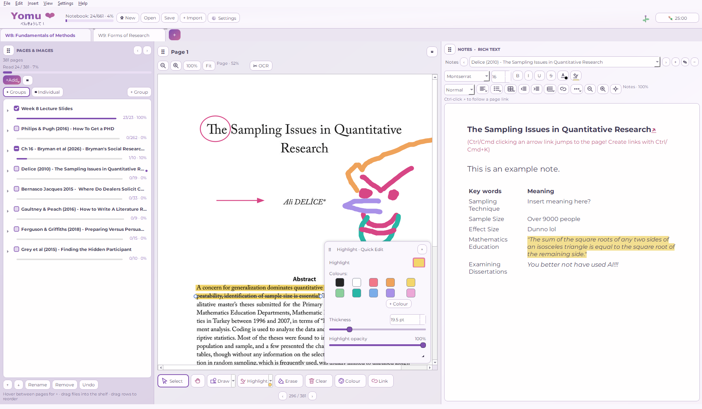
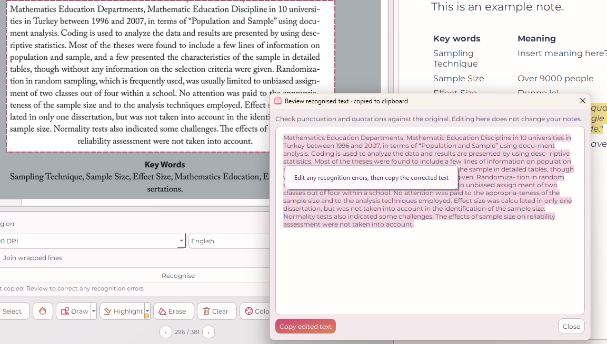
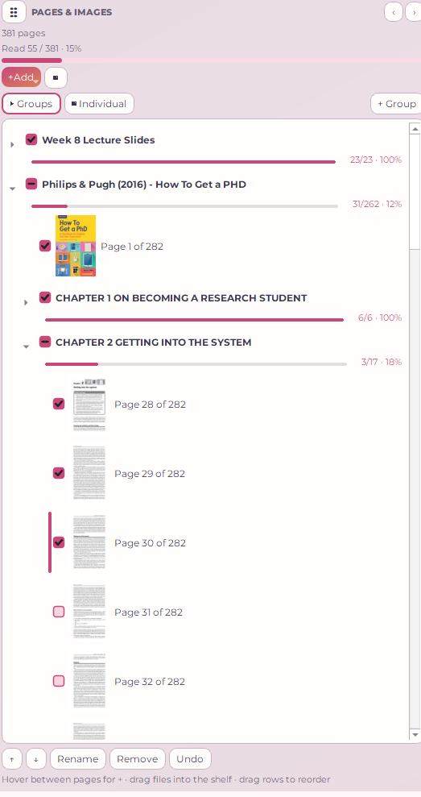
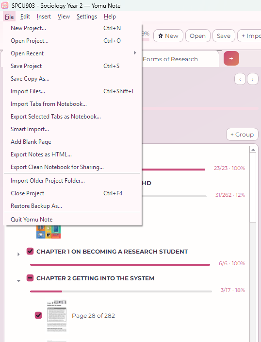
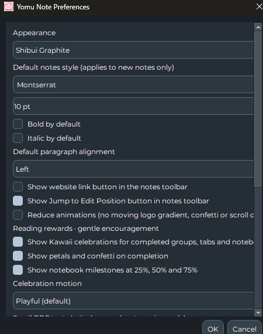

<div align="center">
  

  # Yomu Note 🌸

  **A cosy, offline-first reading and study notebook — made to share.**

  *Import readings. Highlight pages. Write notes. Tick off your progress. Share a whole week's materials with your classmates.*

  **v0.8.1b · Public preview / pre-1.0**
</div>

## ⬇️ Get Yomu Note

**v0.8.1b public preview (release candidate)** · [GitHub Releases](https://github.com/alteredwavestudios/Yomu-Note-Release/releases)

The next installer release is under review. **Draft releases are not public downloads.** Once a candidate has passed installation checks and been published, its files will appear on the Releases page.

| Platform | Distribution | Installation |
| --- | --- | --- |
| **Windows 10/11 (64-bit)** | Setup EXE (when published) | Download from [Releases](https://github.com/alteredwavestudios/Yomu-Note-Release/releases), install, then launch from Start |
| **macOS — Apple Silicon (M-series)** | DMG (when published) | Download from [Releases](https://github.com/alteredwavestudios/Yomu-Note-Release/releases) and drag Yomu Note to Applications |
| **macOS — Intel** | DMG (when published) | Download from [Releases](https://github.com/alteredwavestudios/Yomu-Note-Release/releases) and drag Yomu Note to Applications |
| **Linux** | **Install/run from GitHub source** (no AppImage) | Follow the [Linux source instructions](docs/INSTALL.md) |

> **Preview release:** Windows and macOS builds are unsigned, and the Mac builds are not notarised, so system security prompts may appear. GitHub's automatic “Source code” ZIPs are not native installers. Native packages still require clean-machine acceptance testing. See [installation and troubleshooting](docs/INSTALL.md).

## Take a look

### 1. All your studying in one place



PDF preview in the middle, organised reading material on the left, and formatted notes on the right. Work on a chapter without losing the rest of your notebook.

### 2. Select text with offline OCR



Select text directly from scanned PDFs or images, review the recognised words, and copy them into your notes. OCR runs locally using Tesseract. Windows and macOS installers bundle an English model. Linux source users install Tesseract locally (see the installation guide).

### 3. Chapters, checklists and reading progress



Organise pages into chapters and groups, track your reading with checkboxes, and watch your group, tab and notebook completion percentages update.

### 4. Share complete tabs with classmates



**File → Import Tabs from Notebook…** lets you choose individual tabs from a `.yomunote` project; **Export Selected Tabs as Notebook…** creates a shareable project with only the tabs you choose. Source pages, groups, annotations and rich-text notes travel together. You can also drag a `.yomunote` file onto the window to review its tabs.

<details>
<summary>More: colours and settings</summary>



Choose your theme, typography and how lively you want the reading rewards to feel.
</details>

## Features

- **Portable, shareable notebooks:** Full `.yomunote` projects and individual tab exchange, with one-step Undo/Redo for imported batches.
- **Smart Import 3.0:** Choose PDF page ranges and bookmark chapters, or keep all pages by default.
- **Reading navigator:** Nested groups, page thumbnails, drag-and-drop ordering, titles and reading progress.
- **Document annotation:** Highlights, drawings, shapes and page-relative annotations.
- **Rich-text notes:** Multiple notes pages per tab, tables, links, typography, formatting and editor Undo/Redo.
- **Offline OCR:** Text extraction from PDF/image selections with adjustable DPI and a review-and-copy step.
- **Focus tools:** Pomodoro timer and optional gentle reading rewards.
- **Offline-first:** No account, server or cloud connection required for normal reading, notes, tab exchange or OCR.

See the illustrated **[5-minute quick start](docs/QUICK_START.md)** for the main workflow, or the [complete feature guide](docs/FEATURE_GUIDE.md).

## Start sharing readings

1. Prepare a tab with your reading and notes (for example, “Week 4 — Weber”).
2. Choose **File → Export Selected Tabs as Notebook…** and tick only what you want to share.
3. Send the exported `.yomunote` file through your class chat or shared drive.
4. The recipient opens their own project and chooses **File → Import Tabs from Notebook…** (or drops the file onto Yomu Note).
5. They select the tabs, review the import, and add them without overwriting their existing work. One Undo reverses the import batch.

**Privacy and copyright:** Sharing a tab includes its underlying reading files and your notes/annotations. Check that you have permission to redistribute lecture slides, articles and books, and review notes for personal information before exporting.

## Documentation

- [Installation on Windows, macOS and Linux](docs/INSTALL.md)
- [Quick start with screenshots](docs/QUICK_START.md)
- [Features and shortcuts](docs/FEATURE_GUIDE.md)
- [Build and publish downloadable installers](docs/BUILD_RELEASES.md)
- [Beginner's architecture walkthrough](BEGINNERS_ARCHITECTURE_GUIDE.md)
- [Contributing and running tests](CONTRIBUTING.md)
- [Security and responsible disclosure](SECURITY.md)
- [v0.8.1b release notes](RELEASE_NOTES_v0.8.1b.md)
- [Previous versions and QA notes](docs/HISTORY.md)

## Build from source

If you want to contribute or no release installer is available yet, you need **Python 3.10+** and an environment that can install PySide6/PDFium/Pillow:

```bash
python -m venv .venv
# Activate .venv for your system, then:
python -m pip install -r requirements.txt
python main.py
```

The repository also includes `run-windows.bat`, `run-mac.command` and `run-linux.sh` helpers, plus native build scripts. Details: [docs/BUILD_RELEASES.md](docs/BUILD_RELEASES.md).

## Status and known limits

This is an early public preview, **not v1.0**. The underlying notebook file format is 5, and `.yomunote` saves record the producing application version separately. Back up important notebooks before upgrading. Some Microsoft Office and EPUB imports require converters installed on the user's computer. Notebooks from strangers can contain malicious input; the application is not a security sandbox.

Current development priorities include sticky-note/photo annotations, voice dictation and further recovery/performance hardening. The [pre-GitHub security audit](SECURITY_AUDIT_081A.md) documents outstanding issues.

**Licence:** Yomu Note’s original source code is licensed under **[GNU GPL v3.0 or later](LICENSE)** (`GPL-3.0-or-later`). Third-party libraries, PDF/OCR components and fonts retain their own licences; see [third-party notices](THIRD_PARTY_NOTICES.md) and [licensing details](LICENSING_DECISION.md). Files created by users are not automatically GPL-licensed.
