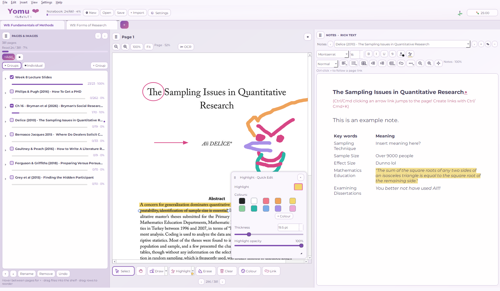
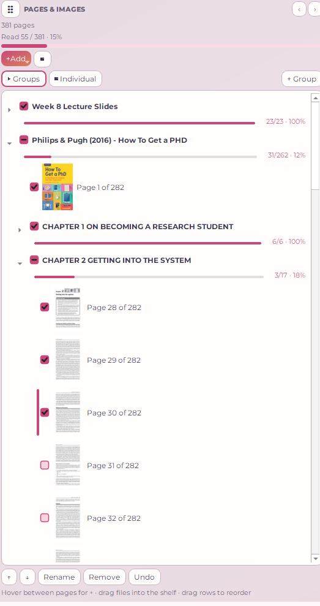
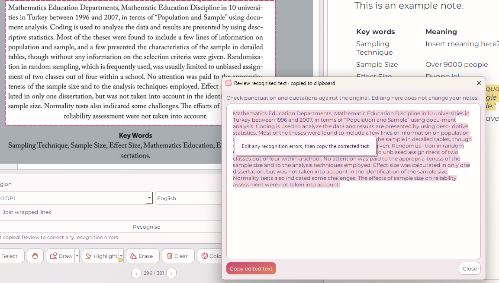
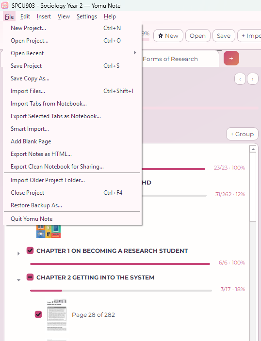
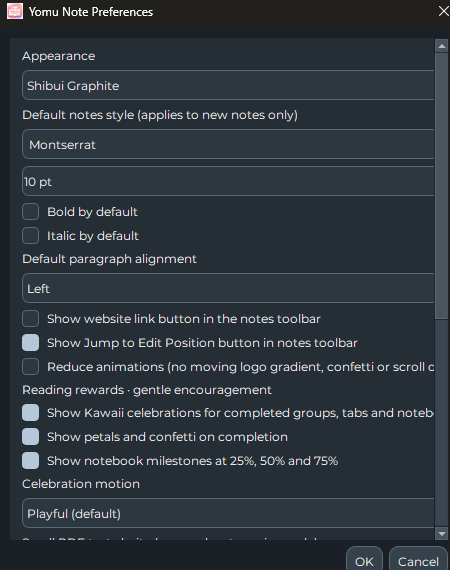

# Feature guide

## The three panels

- **Pages & Images (left):** Import source documents, browse thumbnails, organise nested groups, rename pages and check off reading.
- **Full-page Preview (centre):** Read PDFs and images, zoom, select annotation tools and OCR a marked area.
- **Notes (right):** Write and format rich text, create multiple notes pages, add lists/tables and link to pages.

## Smart Import

Use **File → Smart Import…** for a PDF with several chapters. Choose all pages, custom ranges and/or bookmark sections. Preview the selection. If both page and chapter filters are selected, only their overlap is imported. Original PDF page numbers are retained.

## Reading progress

Tick pages as read. Parents show aggregate group progress, and notebook-level progress tracks the whole project. Expand/collapse groups to hide sections you aren't studying right now.

## Annotating and OCR

Select the **Draw**, **Highlight**, **Erase**, or **Select** tools below the preview. Drawing and highlighting are saved with the notebook. For OCR, mark one or more rectangles, choose the language and recognition resolution, then review the result before pasting into notes.

## Notes

Each project tab can have multiple notes pages. Use the editor toolbar for fonts, styles, alignment, lists, hyperlinks and tables. The app keeps note edits separate from changes to the page navigator. Normal Ctrl/Cmd shortcuts are available; specifics can vary by OS and keyboard layout.

## Tab Exchange

**Import Tabs from Notebook…** reads a separate `.yomunote` file and lets you select individual incoming tabs. The imported tabs are independent copies of the source. **One Undo** reverses the whole imported batch, and Redo restores it during the active session.

**Export Selected Tabs as Notebook…** makes a fresh standalone file with only chosen tabs and their referenced files and notes. It's particularly useful for weekly lecture readings or study-group hand-outs. Drop a `.yomunote` file from your file manager onto Yomu Note to open the selection workflow.

## Appearance, focus and accessibility

Settings includes colours, notes-font defaults, motion reduction and optional celebration effects. Yomu Note includes a Pomodoro timer. Full offline microphone transcription is **planned for a later release**, not included in v0.8.1a.

## Current limitations

Office and EPUB conversion can require external tools; this differs from the bundled English Tesseract OCR in packaged releases. Large document saves can briefly affect interface responsiveness. The app is a preview release; back up coursework before trying new versions. See the security audit and release notes for the full list.
