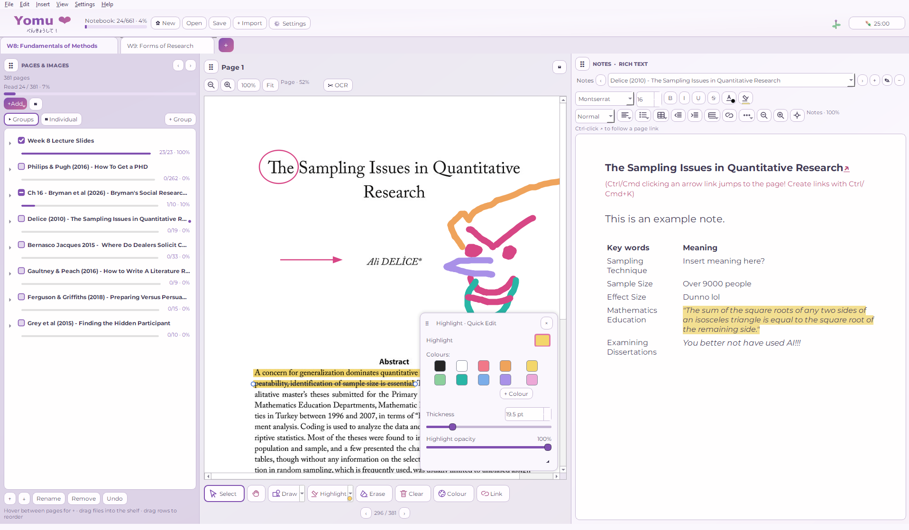
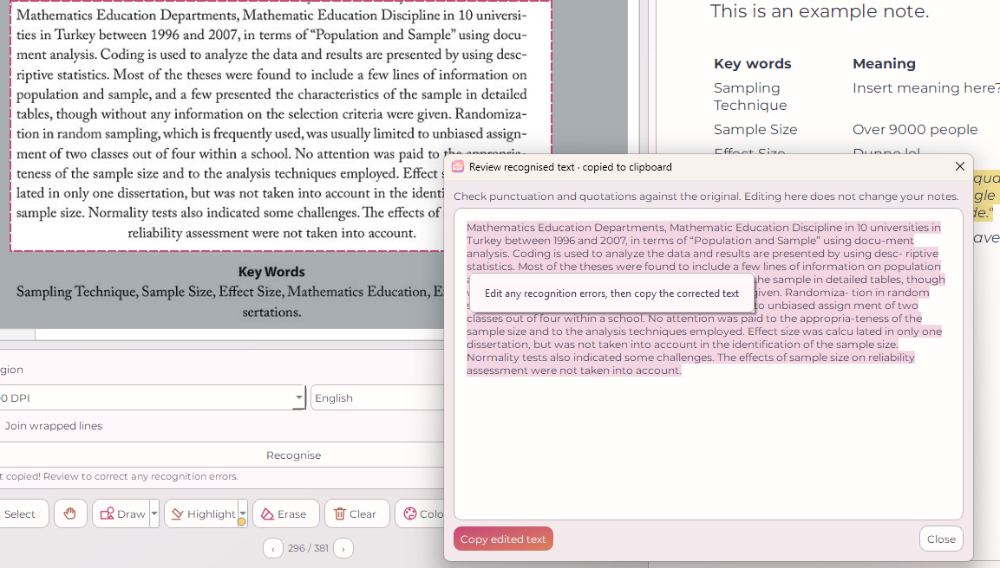
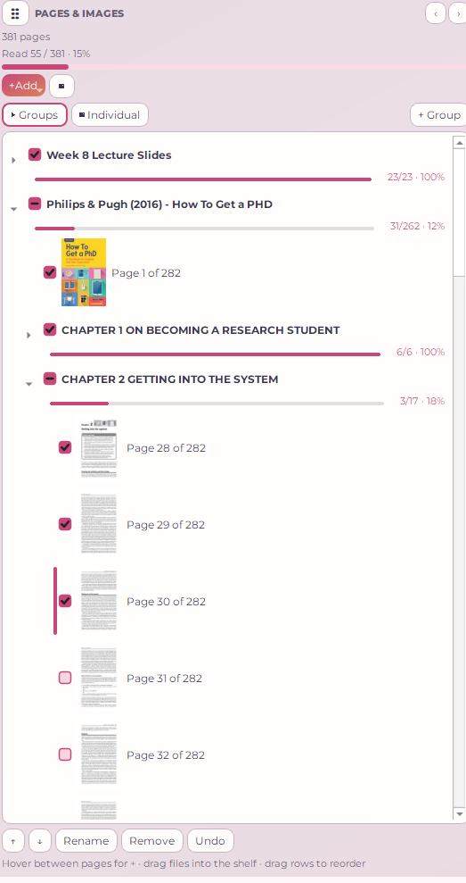
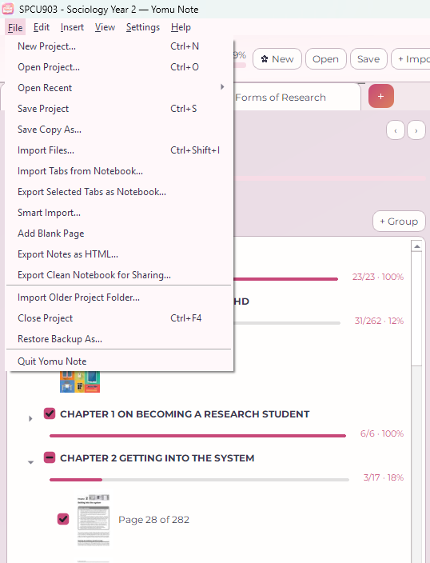
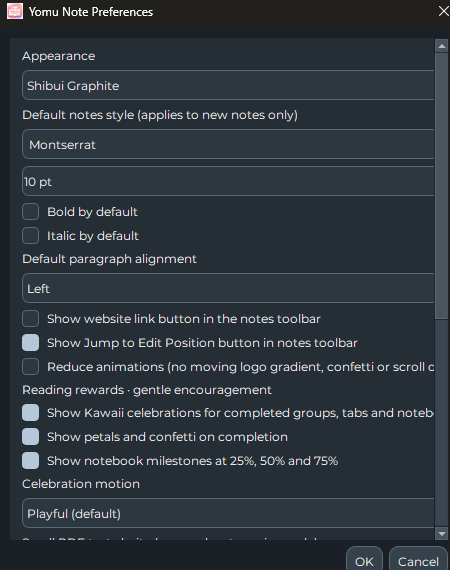

# Yomu Note — Your first five minutes 🌸

Welcome! You don't need an account, an internet connection, or any experience with note-taking software to start reading.

## 1. Create or open your notebook

Launch Yomu Note and choose **New** or **File → Open Project…**. A `.yomunote` file is your portable notebook. Save it somewhere like Documents, **not inside the source-code folder**.

Think of the window as three areas:

| Left: Pages & Images | Middle: Preview | Right: Notes |
| --- | --- | --- |
| Organise readings, chapters and checklists | Read PDFs/images and annotate them | Write formatted notes, tables and links |

Tabs along the top can represent a week, module, essay or another topic.

## 2. Import some reading

Choose **+ Import**, **File → Import Files…**, or **Smart Import…**. For a long PDF, Smart Import can let you include **all pages** (the default), a custom range (such as `1-15, 27-34`), or selected bookmark chapters. Check the preview before confirming.

## 3. Highlight, draw and copy scanned text

Use the annotation tools below the preview to highlight or draw on a page. To recognise writing printed inside a scanned image, select **OCR**, mark the area, then **Recognise**.

Review the words for scanning errors and choose **Copy edited text**. OCR runs locally; it does not upload your reading to a service.

## 4. Keep track of the reading

Open the page groups, tick individual pages as you've read them, and watch the group's progress bar change. You can collapse chapters when you want a quieter view.

**Tip:** Seeing a PDF page in the preview is different from explicitly selecting it in the left navigator. Actions that use a selected page anchor rely on your **left-click selection**, not simply what is being previewed.

## 5. Share a week's work with classmates

**To send a tab:** choose **File → Export Selected Tabs as Notebook…**, tick only the tabs you want and save the `.yomunote` file. Send it like any other document.

**To receive a tab:** keep your own notebook open and choose **File → Import Tabs from Notebook…** (or drop the `.yomunote` file onto Yomu Note). Pick the incoming tabs. They are **copied into new tabs**, without replacing your existing work, and the import batch can be undone in one action.

**Check before sharing:** An exported tab includes its PDFs, images, personal notes and annotations. Don't distribute materials you don't have permission to share.

## 6. Make it your own

Select **Settings** to choose themes, a default notes font and optional celebrations for completing reading groups.

## Save safely

Yomu Note saves when needed and supports an autosave interval of around one minute after changes. Still use **Save** before shutting down, keep backups of important coursework, and use **Save Copy As…** when experimenting with an older notebook.

If something isn't working, open a **GitHub Issue**, describe the steps, the version shown in **About**, your operating system, and any error text. **Never attach a personal `.yomunote` notebook to a public issue unless you've reviewed it for private material.**
